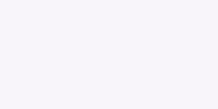

  
   
  <a href="https://in.pinterest.com/pin/908179081129024280/">Original clip ↗</a>

# Ujan Dey

*I keep building things to see what happens.*

I’m a physics undergraduate at **NIT Agartala**, interested in how machines learn, remember, and forget. I’m looking for research opportunities in continual learning and neuromorphic computation.

---

## What we forget

### [MNEMA](https://github.com/ujandey/mnema)

*What does a model forget when it learns something new?*

A continual learning prototype in NumPy that combines sparse representations, associative memory, a spiking-style learner, and consolidation. I evaluated it on Split-MNIST Class-IL alongside five baselines, with ten seeds per method.

| Final accuracy | Forgetting |
| :-- | :-- |
| **77.12 ± 0.87%** | **6.53 ± 1.41 percentage points** |

[Code](https://github.com/ujandey/mnema) · [Technical report](https://github.com/ujandey/mnema/blob/main/docs/mnema.pdf) · [Benchmark results](https://github.com/ujandey/mnema/tree/main/results/research_benchmark/full)

---

## Elsewhere in the notebook

### [Python Chess Engine](https://github.com/ujandey/chess-engine)

*What goes into choosing one move?*

A Python engine with legal move generation, iterative deepening, alpha-beta search, transposition tables, UCI support, a Tkinter GUI, and 83 tests.

### [World Cup 2026 Predictor](https://github.com/ujandey/wc2026predictor)

*One tournament, many possible endings.*

Sequential Elo ratings and calibrated XGBoost probabilities feed a Monte Carlo tournament simulation. The match model reached about 57% accuracy on a chronological three-class holdout.

---

## In the margins

Currently reading about spiking neural networks and thinking about how to tell whether a model has retained what it learned.

[Portfolio](https://ujandey.me) · [Email](mailto:ujandey007@gmail.com)
